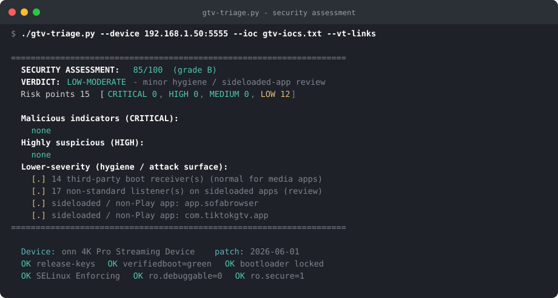
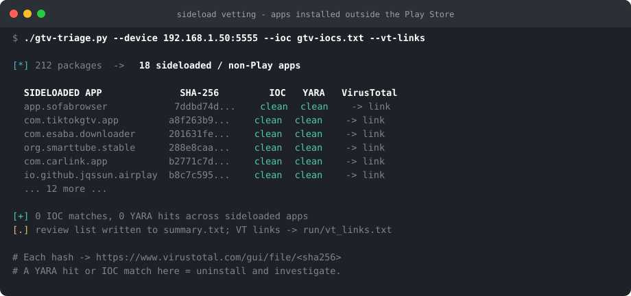

<div align="center">

# 📺 gtv-triage

### Non-root security triage for any Android TV & Google TV device

**Vet the apps you sideloaded, and hunt BADBOX / BADBOX 2.0 / Android.Vo1d — on any Android TV or Google TV device, no root, no cloud, pure Python stdlib.**

[](https://github.com/crash101g/gtv-triage/actions/workflows/ci.yml)


</div>

> ## 🚧 Work in progress
> This toolkit is **actively being built and calibrated.** The core triage, scoring,
> IOC and YARA engines work and have been validated against a real retail device —
> but detection content, scoring weights, and VirusTotal automation are still
> evolving. Treat every result as a **lead for a human analyst**, not a verdict.
> Expect breaking changes. Feedback and IOC contributions welcome — see
> [CONTRIBUTING.md](CONTRIBUTING.md).

---

## Who it's for

`gtv-triage` works on **any** Android TV / Google TV device — a Chromecast with Google
TV, an onn., a Shield, a TCL/Sony set, an **Amazon Fire TV Stick** (Fire OS), or a
no-name AOSP box. It answers two questions over plain ADB-over-Wi-Fi in about 30
seconds, without rooting, flashing, or sending anything to the cloud:

### 1. 🧩 "I sideloaded apps — are any of them sketchy?"
The moment you install an APK from **outside the Play Store** — Downloader, a GitHub
release, an APK-mirror site, a forum link — Google Play Protect's review no longer
applies. That app can ship adware, proxyware ("earn money" SDKs that rent out your
connection), or an outright backdoor, and nothing on the device tells you. `gtv-triage`
**inventories every sideloaded app, hashes it, scans it with YARA, matches it against a
threat-intel IOC feed, and hands you a VirusTotal link for each one** — so you can vet
what you installed instead of trusting it blindly. This is the everyday use case, and it
applies to perfectly legitimate, Play-certified devices.

### 2. 🦠 "Is my cheap box one of the infected ones?"
Millions of off-brand Android TV boxes ship with **preinstalled malware** — BADBOX,
BADBOX 2.0 (Triada-based), and Android.Vo1d — turning living rooms into residential
proxy nodes and ad-fraud bots. The FBI issued a [public advisory](https://www.ic3.gov/PSA/2025/PSA250605)
on BADBOX 2.0 in 2025. Most owners can't root these boxes or install an AV. `gtv-triage`
checks firmware integrity and sweeps for the known packages, dropped artifacts, native
libs, and C2 infrastructure of these families.

Either way, the output is the same: a **graded, severity-ranked report** plus the raw
evidence to confirm every flag by hand.

---

## 📸 See it in action

**One command → a graded security assessment:**



**Auto-discovers TV devices on your LAN:**


**Hashes every APK, scans with YARA, and hands you VirusTotal links (no API key needed):**


**Vets every app you installed outside the Play Store — IOC, YARA and VirusTotal at a glance:**



> **Screenshots render natively on GitHub.** They are self-contained **static SVGs**
> (only `<rect>`/`<circle>`/`<text>` — no scripts, external fonts, or animation), the
> category GitHub's SVG sanitizer renders reliably. Verified served from GitHub's own
> `/raw/main/assets/*.svg` path (not the camo proxy) as `image/svg+xml`, HTTP 200.
> Device IP and APK hashes shown are sanitized/truncated — no real device data.

---

## ✨ Features

| | |
|---|---|
| 🔍 **LAN auto-discovery** | Finds Android/Google TV devices via mDNS + Cast + subnet sweep, then connects over ADB |
| 🧩 **Sideload vetting** | Inventories every non-Play app, hashes it, YARA-scans pulled APKs, and links each to VirusTotal |
| 🛡️ **Firmware integrity** | Verified boot, bootloader lock, SELinux, release-keys, `ro.debuggable`/`ro.secure` |
| 🦠 **Known-malware checks** | Vo1d / BADBOX / BADBOX 2.0 packages, dropped artifacts, native libs |
| 📇 **182-indicator IOC feed** | Packages, paths, 100+ C2 domains, proxyware SDKs — substring-matched, editable |
| 🧬 **5 YARA rules** | Vo1d backdoor, BADBOX T95, BADBOX 2.0 loader, PEACHPIT proxyware, shared C2 domains |
| 📊 **Graded scoring** | Severity-weighted 0–100 score with a CRITICAL/HIGH/MEDIUM/LOW breakdown |
| 🔗 **VirusTotal built-in** | API enrichment *or* `--vt-links` mode that generates clickable GUI links with **no API key** |
| 🧮 **Persistence sweep** | Boot receivers, init services, jobs, alarms, device admins, a11y/notification listeners, IMEs |
| 🌐 **Network analysis** | Listening sockets classified against expected Cast/mDNS ports; remote endpoints resolved |
| 📁 **Diff-friendly runs** | Every run is normalized + sorted + diffed against the last, so firmware updates are easy to compare |
| 🔒 **Privacy-first** | 100% local. Nothing leaves your network unless *you* open a VirusTotal link |

---

## 🚀 Quick start

```bash
# 0. Requirements: adb in PATH, Python 3.8+ (stdlib only — nothing to pip install)

# 1. Enable "USB/Network debugging" on the TV (Settings → System → Developer options)

# 2. Scan your LAN and pick a device to triage
./gtv-triage.py --scan

# 3. Full triage with IOC matching + VirusTotal links (no API key required)
./gtv-triage.py --device 192.168.1.50:5555 --ioc gtv-iocs.txt --vt-links

# 4. Pull sideloaded APKs and scan them with YARA
./gtv-triage.py --device 192.168.1.50:5555 --pull-apks new
yara -r gtv-malware.yar ./pulled-apks/
```

### 🧩 Vetting sideloaded apps (the everyday workflow)

Installed something from outside the Play Store and want a second opinion? This is the
path:


```bash
# Triage + IOC match + clickable VirusTotal links for anything suspicious — no key needed
./gtv-triage.py --device 192.168.1.50:5555 --ioc gtv-iocs.txt --vt-links

# Pull the non-Play APKs and scan their real contents (unpacked DEX, libs, assets)
./gtv-triage.py --device 192.168.1.50:5555 --pull-apks new
yara -r gtv-malware.yar ./pulled-apks/
```

The run's `summary.txt` lists every **sideloaded / non-Play app** by name, and
`norm/apk_hashes.txt` gives you the SHA-256 of each one. Drop a hash into
`https://www.virustotal.com/gui/file/<sha256>` (or use `--vt-links`) to see how 70+
AV engines rate it. A YARA hit or an IOC match on a sideloaded app is your signal to
uninstall and investigate.

Have a VirusTotal API key? Get automatic detection scores for every hash, IP and domain:

```bash
VT_API_KEY=xxxxx ./gtv-triage.py --device 192.168.1.50:5555 --virustotal
```

---

## 📂 What's in the box

| File | Purpose |
|---|---|
| `gtv-triage.py` | The triage engine — discovery, collection, scoring, VirusTotal, diffing |
| `gtv-iocs.txt` | 182 indicators (Vo1d + BADBOX/BADBOX 2.0 + proxyware) — edit freely |
| `gtv-malware.yar` | 5 YARA rules for pulled APKs / unpacked DEX / recovered ELF backdoors |

Each run writes to `tv-triage-runs/<timestamp>_<build-id>/`:
- `raw/` — unmodified command output
- `norm/` — normalized, sorted, diff-friendly lists (incl. `apk_hashes.txt`)
- `summary.txt` — the graded red-flag report
- `diff.txt` — changes vs. the previous run

---

## 🧪 Validated against a real device

First real-world target: a retail **onn. 4K Pro** — a legitimate, **Google-certified,
Play-Protect Google TV device** (Android 14), *not* an off-brand box. Result —
**85/100, grade B, clean:** locked/verified firmware, SELinux enforcing, 0/182 IOC
matches, and all sideloaded APKs scanned clean against the YARA rules with hashes
verified against the device.

This is exactly the sideload-vetting use case in action: the device itself was fine,
and the tool's real job was to **surface the 16 apps installed outside the Play Store**
and confirm — via YARA, IOC matching, and hashes — that none were malicious. The
low-severity points were ordinary hygiene (third-party boot receivers, a few sideloaded
apps worth a look).

---

## ⚠️ Scope & honest limitations

- **Non-root sees limited state.** A high score is *not* a clean bill of health —
  most of `/data/**` and `/system` are unreadable without root. A clean result means
  "nothing visible from here," so corroborate with IOC matching, APK hashing and YARA.
- **Scoring is heuristic,** not a definitive verdict. Confirm every flag by hand.
- **IOC/C2 infrastructure rotates.** Refresh `gtv-iocs.txt` before an engagement.
- **Dual-use flags happen.** Proxyware SDKs also ship in legitimate "earn money" apps —
  a hit means *review*, not *proof*.
- **Works on any device, but the two threats differ.** The *preinstalled-malware*
  families (BADBOX/Vo1d) are overwhelmingly found on **non-Play-Protect-certified AOSP
  boxes**, per Google — a certified device is very unlikely to ship with them. The
  *sideload-vetting* use case applies to **every** Android TV / Google TV device,
  certified or not, because sideloading bypasses Play Protect regardless of brand.
- **Fire OS aware.** On Amazon Fire TV (which has no Play Store) the tool auto-detects
  Fire OS and treats the **Amazon Appstore / Amazon-signed updaters** as a trusted store,
  so only *genuinely* sideloaded apps (Downloader, APK mirrors, `null` installer) are
  flagged — and Amazon system listeners aren't mislabeled as non-standard. Discovery
  finds a Fire Stick via the ADB port-5555 sweep (it doesn't announce Google Cast), or
  just use `--device <ip>:5555`.

---

## 🙏 Sources & credits

- **BADBOX 2.0** — [HUMAN Security (Satori)](https://www.humansecurity.com/learn/blog/satori-threat-intelligence-disruption-badbox-2-0/)
- **Android.Vo1d** — [Doctor Web](https://github.com/DoctorWebLtd/malware-iocs/tree/master/Android.Vo1d)
- **Original BADBOX / T95** — [DesktopECHO/T95-H616-Malware](https://github.com/DesktopECHO/T95-H616-Malware)
- **FBI IC3** — BADBOX 2.0 public service announcement (2025)

---

## 🤝 Contributing

🚧 This is a work in progress and contributions are welcome — especially **fresh IOCs**
and **YARA tuning**. See **[CONTRIBUTING.md](CONTRIBUTING.md)** for how to add indicators,
write rules that survive CI, and the pre-PR checks. New indicators must come with a
public source, and never include real device data (serials, IPs, app lists) in a PR.

---

## 📜 License

MIT — see [LICENSE](LICENSE). Provided for **authorized** testing of devices you own
or have permission to assess. You are responsible for how you use it.
