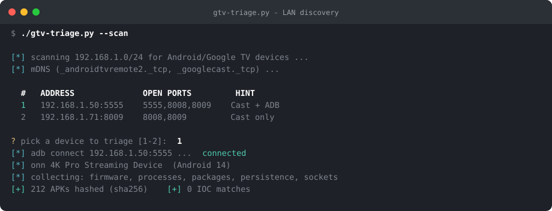
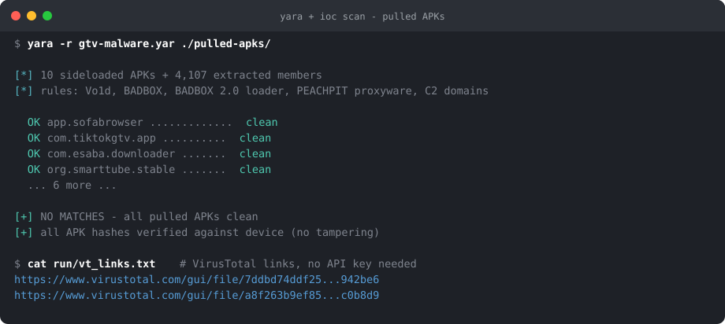

<div align="center">

# 📺 gtv-triage

### Non-root security triage for Android TV & Google TV boxes

**Hunt BADBOX, BADBOX 2.0, and Android.Vo1d on off-brand streaming boxes — no root, no cloud, pure Python stdlib.**

[](https://github.com/crash101g/gtv-triage/actions/workflows/ci.yml)


</div>

> ## 🚧 Work in progress
> This toolkit is **actively being built and calibrated.** The core triage, scoring,
> IOC and YARA engines work and have been validated against a real retail device —
> but detection content, scoring weights, and VirusTotal automation are still
> evolving. Treat every result as a **lead for a human analyst**, not a verdict.
> Expect breaking changes. Feedback and IOC contributions welcome.

---

## Why this exists

Millions of cheap Android TV boxes ship with **preinstalled malware** — BADBOX,
BADBOX 2.0 (Triada-based), and Android.Vo1d — turning living rooms into residential
proxy nodes and ad-fraud bots. The FBI issued a [public advisory](https://www.ic3.gov/PSA/2025/PSA250605)
on BADBOX 2.0 in 2025.

The problem: most owners can't root these boxes, can't install an AV, and have no
way to know if their device is one of the infected ones. **`gtv-triage` answers that
question over plain ADB-over-Wi-Fi in about 30 seconds — without rooting, flashing,
or sending anything to the cloud.**

---

## 📸 See it in action

**One command → a graded security assessment:**


**Auto-discovers TV boxes on your LAN:**



**Hashes every APK, scans with YARA, and hands you VirusTotal links (no API key needed):**



---

## ✨ Features

| | |
|---|---|
| 🔍 **LAN auto-discovery** | Finds Android/Google TV boxes via mDNS + Cast + subnet sweep, then connects over ADB |
| 🛡️ **Firmware integrity** | Verified boot, bootloader lock, SELinux, release-keys, `ro.debuggable`/`ro.secure` |
| 🦠 **Known-malware checks** | Vo1d / BADBOX / BADBOX 2.0 packages, dropped artifacts, native libs |
| 📇 **182-indicator IOC feed** | Packages, paths, 100+ C2 domains, proxyware SDKs — substring-matched, editable |
| 🧬 **5 YARA rules** | Vo1d backdoor, BADBOX T95, BADBOX 2.0 loader, PEACHPIT proxyware, shared C2 domains |
| 📊 **Graded scoring** | Severity-weighted 0–100 score with a CRITICAL/HIGH/MEDIUM/LOW breakdown |
| 🔗 **VirusTotal built-in** | API enrichment *or* `--vt-links` mode that generates clickable GUI links with **no API key** |
| 🧮 **Persistence sweep** | Boot receivers, init services, jobs, alarms, device admins, a11y/notification listeners, IMEs |
| 🌐 **Network analysis** | Listening sockets classified against expected Cast/mDNS ports; remote endpoints resolved |
| 📁 **Diff-friendly runs** | Every run is normalized + sorted + diffed against the last, so firmware updates are easy to compare |
| 🔒 **Privacy-first** | 100% local. Nothing leaves your network unless *you* open a VirusTotal link |

---

## 🚀 Quick start

```bash
# 0. Requirements: adb in PATH, Python 3.8+ (stdlib only — nothing to pip install)

# 1. Enable "USB/Network debugging" on the TV (Settings → System → Developer options)

# 2. Scan your LAN and pick a device to triage
./gtv-triage.py --scan

# 3. Full triage with IOC matching + VirusTotal links (no API key required)
./gtv-triage.py --device 192.168.1.50:5555 --ioc gtv-iocs.txt --vt-links

# 4. Pull sideloaded APKs and scan them with YARA
./gtv-triage.py --device 192.168.1.50:5555 --pull-apks new
yara -r gtv-malware.yar ./pulled-apks/
```

Have a VirusTotal API key? Get automatic detection scores for every hash, IP and domain:

```bash
VT_API_KEY=xxxxx ./gtv-triage.py --device 192.168.1.50:5555 --virustotal
```

---

## 📂 What's in the box

| File | Purpose |
|---|---|
| `gtv-triage.py` | The triage engine — discovery, collection, scoring, VirusTotal, diffing |
| `gtv-iocs.txt` | 182 indicators (Vo1d + BADBOX/BADBOX 2.0 + proxyware) — edit freely |
| `gtv-malware.yar` | 5 YARA rules for pulled APKs / unpacked DEX / recovered ELF backdoors |

Each run writes to `tv-triage-runs/<timestamp>_<build-id>/`:
- `raw/` — unmodified command output
- `norm/` — normalized, sorted, diff-friendly lists (incl. `apk_hashes.txt`)
- `summary.txt` — the graded red-flag report
- `diff.txt` — changes vs. the previous run

---

## 🧪 Validated against a real device

First real-world target: a retail **onn. 4K Pro (Google TV, Android 14)**.
Result — **85/100, grade B, clean:** locked/verified firmware, SELinux enforcing,
0/182 IOC matches, and all sideloaded APKs scanned clean against the YARA rules with
hashes verified against the device. The low-severity points were ordinary hygiene
(third-party boot receivers, a few sideloaded apps to review).

---

## ⚠️ Scope & honest limitations

- **Non-root sees limited state.** A high score is *not* a clean bill of health —
  most of `/data/**` and `/system` are unreadable without root. A clean result means
  "nothing visible from here," so corroborate with IOC matching, APK hashing and YARA.
- **Scoring is heuristic,** not a definitive verdict. Confirm every flag by hand.
- **IOC/C2 infrastructure rotates.** Refresh `gtv-iocs.txt` before an engagement.
- **Dual-use flags happen.** Proxyware SDKs also ship in legitimate "earn money" apps —
  a hit means *review*, not *proof*.
- Google notes these infections are on **non-Play-Protect-certified AOSP boxes**, not
  licensed Google TV / Android TV devices. "Google TV" is used loosely here for the
  affected low-cost streaming-box ecosystem.

---

## 🙏 Sources & credits

- **BADBOX 2.0** — [HUMAN Security (Satori)](https://www.humansecurity.com/learn/blog/satori-threat-intelligence-disruption-badbox-2-0/)
- **Android.Vo1d** — [Doctor Web](https://github.com/DoctorWebLtd/malware-iocs/tree/master/Android.Vo1d)
- **Original BADBOX / T95** — [DesktopECHO/T95-H616-Malware](https://github.com/DesktopECHO/T95-H616-Malware)
- **FBI IC3** — BADBOX 2.0 public service announcement (2025)

---

## 📜 License

MIT — see [LICENSE](LICENSE). Provided for **authorized** testing of devices you own
or have permission to assess. You are responsible for how you use it.
