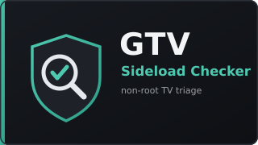

# GTV Sideload Checker (Android app) — 🚧 scaffold / WIP

An on-device port of the **plain sideload-vetting** tier of
[`gtv-triage`](../README.md). Runs directly on an Android TV / Google TV / Fire TV
device as a sideloaded app — **no PC, no ADB, no root** — and vets the apps you
installed outside the official store.

> **Status:** compiling scaffold with the core logic ported and a first working
> app-list screen. Not yet a finished app — see *Roadmap* below.



## What it does today

- Enumerates every installed package (`QUERY_ALL_PACKAGES`)
- Classifies each app's installer — **Fire OS aware** (Amazon Appstore trusted on
  Fire OS, Google Play everywhere) — to flag genuinely **sideloaded** apps
- Computes the **SHA-256** of each third-party APK
- Substring-matches every app against the bundled **`gtv-iocs.txt`** feed
- **On-device YARA**: scans each third-party APK's *decompressed* ZIP entries
  (DEX, `lib/*.so`, manifest, resources) against the bundled **`gtv-malware.yar`**
  rules — a pure-Kotlin matcher for the rules' string/condition subset (no NDK,
  no `libyara.so`)
- Best-effort **firmware integrity** (build tags, test-keys, verified boot, SELinux)
- **Persistence-lite** sweep (no root): BOOT_COMPLETED / LOCKED_BOOT receivers,
  enabled accessibility services, notification listeners, active device-admin
  components, and enabled IMEs (with the default flagged) — accessibility, device
  admins and third-party IMEs are surfaced as review flags
- Produces the same **severity-gated 0–100 score / grade / verdict**
- Shows a TV screen: score header + per-app cards (sideloaded / IOC / YARA / store),
  each with its hash and a **tappable VirusTotal link** — D-pad-select any app to open
  a dialog with a **scannable QR code** (TVs rarely have a browser) plus an
  *Open in browser* fallback
- **Export / share** the full report as plain text — ACTION_SEND with a FileProvider
  attachment, degrading to clipboard + an `adb pull`-able file when a TV has no share
  target
- Optional **VirusTotal API** mode — enter a key (⚙, stored app-private) and query
  live detection counts (`malicious / total engines`) per hash, on demand

## Validation status

**Built, installed and run on a real onn. 4K Pro** (jarvis2, Android 14): the app
compiles (Gradle 8.9 / AGP 8.5.2 / SDK 34), launches on the TV, completes a scan,
and renders the full report — and its verdict **matches the validated ADB tool
exactly: 85/100, grade B, 0 IOC, 0 YARA**. D-pad focus, the persistence card, and
the per-app cards (hash + VirusTotal prompt) all work on-device.

Two issues were found and fixed by that on-hardware run:
- **Self-detection** — the app bundles the YARA rules + IOC feed as assets, so
  scanning its *own* APK matched every indicator and self-reported "malicious".
  Fixed by excluding our own package from the inventory.
- **Memory/perf** — the first YARA pass decoded each APK entry to a UTF-16 String
  (and lower-cased a copy), which GC-thrashed the TV heap (196 MB, blocking GCs).
  Rewrote it as a bounded, streaming, single-pass byte matcher with first-byte
  dispatch, and scoped YARA to sideloaded apps only.

Earlier, before the on-device run, the core logic had also been validated:

- **Core triage logic** — the ADB tool these classes port scored the device
  **85/100 (grade B)**: firmware locked/verified, SELinux enforcing, 0/182 IOC hits,
  and it correctly surfaced the sideloaded apps (CouchCam, Sofa/TV browsers, etc.) —
  the same installer-attribution and scoring the Kotlin core reproduces.
- **On-device YARA engine** — the exact matching logic in `YaraEngine` was run
  against the device's **6 real sideloaded APKs** and cross-checked against the
  stock `yara` binary:
  - on all 6 real APKs: **both agree — no hits** (correct; they're clean), and
  - with indicators planted into an APK's entries: the engine reports
    `BADBOX_Loader, Botnet_C2_Domains, Vo1d_Backdoor` — **identical** to `yara -r`
    on the decompressed entries. (Because it decompresses ZIP entries, it actually
    catches strings that raw-byte `yara file.apk` misses inside compressed DEX.)

Still pending: a run on an actual **Fire TV Stick** (Fire OS paths are implemented
and unit-logic-tested, not yet hardware-run), and on a **TCL** Google TV set.

## What it deliberately does NOT do (this tier)

A sandboxed app can't see system-wide processes, listening sockets, native init
services, or run `dumpsys` job/alarm dumps (needs root or the `shell` uid). Those
live in the ADB tool and would require a **Shizuku** or root bridge — planned as a
separate optional mode. The persistence-lite sweep above covers the footholds that
*are* reachable from the sandbox.

## Build & run

Requires Android Studio (Koala+) or a local Gradle 8.9 + Android SDK 34.

```bash
# The Gradle wrapper jar isn't checked in. Either open android/ in Android Studio
# (it generates the wrapper automatically), or generate it once with a local Gradle:
cd android
gradle wrapper        # creates ./gradlew and the wrapper jar

# Then build the debug APK:
./gradlew :app:assembleDebug
# -> app/build/outputs/apk/debug/app-debug.apk
```

Install on a device:

```bash
# Over ADB (dev/testing):
adb install -r app/build/outputs/apk/debug/app-debug.apk

# Or sideload the APK on the device itself via Downloader / a USB drive, then launch
# "GTV Sideload Checker" from the Android TV / Google TV home row.
```

> `QUERY_ALL_PACKAGES` is restricted on Google Play, so this app is meant for
> **sideload distribution**, not the Play Store.

## Project layout

```
android/
  app/src/main/
    AndroidManifest.xml            QUERY_ALL_PACKAGES, LEANBACK launcher
    assets/gtv-iocs.txt            copy of the IOC feed (bundled)
    assets/gtv-malware.yar         copy of the YARA rules (bundled)
    java/com/crash101g/gtvtriage/
      MainActivity.kt              Compose entry point
      core/
        Models.kt                  Severity, AppEntry, TriageReport
        InstallerClassifier.kt     Fire OS detection + trusted-store logic
        PackageInventory.kt        PackageManager enumeration
        ApkHasher.kt               SHA-256 of APKs
        IocMatcher.kt              substring IOC matcher (bundled feed)
        FirmwareIntegrity.kt       Build / SystemProperties / SELinux checks
        PersistenceSweep.kt        boot receivers, a11y, notif, admins, IMEs
        YaraEngine.kt              YARA-subset parser + APK (zip-entry) scanner
        ReportFormatter.kt         plain-text report (summary.txt analogue)
        VirusTotalClient.kt        VT API v3 file-hash lookup (on demand)
        ApiKeyStore.kt             app-private VirusTotal API-key storage
        Scoring.kt                 severity-gated 0–100 score
        TriageEngine.kt            orchestrates the above
      ui/
        TriageViewModel.kt         runs the scan off the main thread
        TriageScreen.kt            score header + app-list cards + VT dialog
        QrCodes.kt                 ZXing QR encoder for VirusTotal links
        ReportShare.kt             ACTION_SEND export + clipboard/file fallback
```

## Roadmap

- [x] Tappable VirusTotal links (QR to scan with a phone + open-in-browser fallback)
- [x] On-device YARA (pure-Kotlin matcher for the rules' string/condition subset)
- [x] Persistence-lite: boot receivers + `Settings.Secure` a11y/notif/IME readouts + device admins
- [x] Optional **VirusTotal API** mode (enter key, show detection counts on demand)
- [ ] Harden key storage with EncryptedSharedPreferences (androidx.security)
- [x] Export / share the report (plain-text, ACTION_SEND + clipboard/file fallback)
- [ ] Optional **Shizuku** mode for process/socket/dumpsys depth (ADB-tool parity)
- [x] Proper TV banner artwork (320×180) + D-pad focus polish (focus highlight +
      scale, initial focus on the action bar)
- [x] Real-device validation on an **onn. 4K Pro** — built, installed, scanned,
      verdict matches the ADB tool (85/B). Fire TV Stick + TCL still to do.
